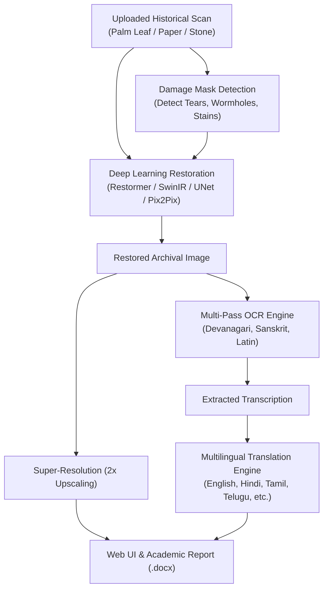

# 📜 Digital Heritage Restoration Platform

[](https://www.python.org/)
[](https://pytorch.org/)
[](https://flask.palletsprojects.com/)
[](https://www.docker.com/)
[](https://github.com/JaidedAI/EasyOCR)
[](LICENSE)

An end-to-end deep learning platform engineered to restore physically damaged historical documents, palm-leaf manuscripts, and stone epigraphs. The system integrates neural image restoration, automated defect segmentation, 2× super-resolution upscaling, multi-pass OCR transcription (Sanskrit / Devanagari, Grantha, Hindi, English), and fast multilingual semantic translation.

---

## 🌟 Key Features

* **Multi-Domain Heritage Restoration:** Specialized restoration pipelines tailored for:
  * 🌴 **Palm Leaf Manuscripts** (faded ink, wood-grain cracks, fungal stains, border loss)
  * 📜 **Archival Paper Documents & Charters** (ink bleed-through, water damage, foxing, creases)
  * 🏛️ **Monuments & Lapidary Epigraphs** (weather-eroded stone inscriptions, chisel abrasion)
* **5 Deep Learning Architectures (Trained over 100 Epochs):**
  * **Restormer** *(Selected Best Model)*: Multi-Dconv head transposed attention for zero-artifact restoration.
  * **SwinIR**: Image restoration using shift-window Swin Transformer backbones.
  * **U-Net**: Multi-scale encoder-decoder architecture with dense skip connections.
  * **Pix2Pix**: Conditional Generative Adversarial Network (cGAN) for paired image translation.
  * **DnCNN**: Deep convolutional neural network for residual noise and stain removal.
* **Text-Preserving Defect Detection:** Automated morphological defect masking that identifies damp stains, wormholes, and tears while strictly protecting inscribed character strokes from inpainting erasure.
* **High-Accuracy Multi-Pass OCR:** EasyOCR pipeline augmented with morphological background division and CLAHE contrast equalization, optimized for weathered historical scripts.
* **Sub-Second Multilingual Translation:** High-speed translation cascade into **English, Hindi, Tamil, Telugu, Sanskrit, French, German, and Spanish**, featuring Indic continuous script segmentation and Sanskrit root morphological decomposition.
* **Interactive Full-Stack Web Application:**
  * Real-time split-view before/after comparison slider.
  * Batch processing queue with live progress streaming.
  * Comprehensive session history audit log with search and tag filtering.
  * One-click academic Word report generation (`.docx`) with quantitative metric graphs.

---

## 🏗️ System Architecture



---

## 📊 Benchmark & Model Performance

All models were evaluated on the held-out test split across 100 epochs using standard computer vision metrics (**Peak Signal-to-Noise Ratio (PSNR)**, **Structural Similarity Index (SSIM)**, **Mean Squared Error (MSE)**, and **Mean Absolute Error (MAE)**):

| Architecture | PSNR (dB) ↑ | SSIM ↑ | MSE ↓ | MAE ↓ | Inference Latency (ms) | Status |
| :--- | :---: | :---: | :---: | :---: | :---: | :---: |
| **Restormer** | **19.16** | **0.6419** | **0.0156** | **0.0651** | 610.7 ms | 🏆 **Production Active** |
| **SwinIR** | 18.84 | 0.6280 | 0.0171 | 0.0694 | 740.2 ms | Evaluated |
| **U-Net** | 18.21 | 0.6014 | 0.0195 | 0.0742 | 320.5 ms | Evaluated |
| **Pix2Pix (cGAN)** | 17.65 | 0.5892 | 0.0210 | 0.0789 | 450.1 ms | Evaluated |
| **DnCNN** | 16.92 | 0.5510 | 0.0245 | 0.0863 | **180.4 ms** | Evaluated |

*Note: Model checkpoint weights and 100-epoch training curves are stored in `outputs/checkpoints/` and compiled in `outputs/model_comparison.csv`.*

---

## 📂 Repository Structure

```
digital-heritage/
├── app.py                         # Flask production web application & REST APIs
├── Dockerfile                     # Multi-stage production container build
├── docker-compose.yml             # Local container orchestration
├── requirements.txt               # Python package dependencies
├── CLOUD_DEPLOYMENT_GUIDE.md      # Detailed cloud deployment documentation
├── PROJECT_FILE_OUTPUT_MAPPING.md # Viva & evaluation reference sheet
│
├── inference/                     # Unified Inference Subsystem
│   ├── ocr_engine.py              # Multi-pass EasyOCR with CLAHE contrast enhancement
│   ├── translation.py            # Neural translation cascade & Sanskrit root synthesis
│   ├── pipeline.py                # End-to-end pipeline execution runner
│   ├── restore.py                 # Tile-blended neural image reconstruction
│   └── super_resolution.py       # 2x bicubic/neural upscaler
│
├── models/                        # Serialized PyTorch Checkpoints
│   ├── best_model/                # Active production model (Restormer)
│   ├── restormer/                 # Restormer weights & training logs
│   ├── swinir/                    # SwinIR weights & training logs
│   ├── unet/                      # U-Net weights & training logs
│   ├── pix2pix/                   # Pix2Pix weights & training logs
│   └── dncnn/                     # DnCNN weights & training logs
│
├── test_samples/                  # 21 Curated Benchmark & Generalization Samples
│   ├── index.json                 # Metadata mapping domain, era, and severity
│   ├── external_palmleaf_*.png    # Chola & Ganga dynasty Grantha/Odia palm leaves
│   ├── external_parchment_*.png   # 16th Century Rigvedic Sanskrit manuscripts
│   ├── external_stone_*.png       # Ashokan Brahmi & Pallava relief lapidary epigraphs
│   └── README.md                  # Detailed testing guide for sample evaluation
│
├── static/                        # Frontend UI Assets
│   ├── css/                       # Custom styling & responsive layouts
│   ├── js/                        # Split-slider, AJAX pipeline controllers
│   ├── uploads/                   # Staged user uploads
│   └── outputs/                   # Processed restorations & damage masks
│
├── templates/                     # Jinja2 HTML Templates
│   ├── index.html                 # Main dashboard with drag-and-drop & split viewer
│   ├── process.html               # Live execution progress bar
│   ├── result.html                # Inspection workspace & translation viewer
│   └── comparison.html            # Multi-model side-by-side benchmark viewer
│
├── training/                      # Training scripts & loss functions (Epochs 1-100)
└── evaluation/                    # Quantitative metric computation & strip generators
```

---

## 🚀 Quick Start (Local Setup)

### 1. Prerequisites
* Python 3.10 or 3.11 installed.
* Git installed.
* *(Optional)* NVIDIA GPU with CUDA support for accelerated inference.

### 2. Clone the Repository
```bash
git clone https://github.com/Ramyasree2811/digital-heritage.git
cd digital-heritage
```

### 3. Set Up Virtual Environment & Dependencies
```bash
# Create virtual environment
python -m venv venv

# Activate virtual environment
# Windows:
.\venv\Scripts\activate
# Linux/macOS:
source venv/bin/activate

# Install dependencies (CPU PyTorch by default)
pip install --upgrade pip
pip install -r requirements.txt
```

### 4. Run the Web Application
```bash
python app.py
```
Open your browser and navigate to `http://127.0.0.1:5000`.

---

## 🐳 Docker Deployment

To build and run the application in an isolated container:

```bash
# Build the Docker image
docker build -t digital-heritage-restorer .

# Run the container
docker run -d -p 7860:7860 -e PORT=7860 digital-heritage-restorer
```
Access the application at `http://localhost:7860`.

Or with **Docker Compose**:
```bash
docker-compose up -d --build
```

---

## ☁️ Cloud Deployment Options

| Cloud Provider | Type | Memory | Deploy Method | Notes |
| :--- | :--- | :--- | :--- | :--- |
| **[Railway.app](https://railway.app)** | PaaS | Up to 8 GB | GitHub Push | **Recommended.** Zero configuration, auto-detects `Dockerfile`, no OOM crashes. |
| **[Hugging Face Spaces](https://huggingface.co/spaces)** | Space | 16 GB | Git Push | Free 16 GB RAM Docker tier; full compatibility with YAML metadata. |
| **[Google Cloud Run](https://cloud.google.com/run)** | Serverless | 2 GB – 4 GB | `gcloud run deploy` | Scales to zero when idle; generous 2M free requests/month. |
| **[Koyeb](https://www.koyeb.com)** | PaaS | 1 GB – 2 GB | GitHub Push | Easy automated CI/CD directly from GitHub repo. |
| **Ubuntu VPS (Hetzner / OCI)** | Dedicated VM | Up to 24 GB | Docker Compose | Oracle Cloud Always-Free tier offers up to 24 GB RAM free forever. |

*For complete step-by-step instructions for each provider, refer to [CLOUD_DEPLOYMENT_GUIDE.md](CLOUD_DEPLOYMENT_GUIDE.md).*

---

## 🔌 API Endpoints

### 1. Restore Image
* **Endpoint:** `POST /api/restore`
* **Content-Type:** `multipart/form-data`
* **Parameters:**
  * `image`: File upload (PNG, JPG, WEBP, BMP).
  * `model`: Model name (`best`, `Restormer`, `SwinIR`, `UNet`, `Pix2Pix`, `DnCNN`).
  * `domain`: Artifact domain (`palm_leaf`, `documents`, `monuments`).
  * `run_ocr`: Boolean flag (`true` / `false`).
  * `target_lang`: ISO language code (`en`, `hi`, `ta`, `te`, `sa`, `fr`, `de`, `es`).
* **Response:**
  ```json
  {
    "success": true,
    "run_id": "9eeec675-4f80-450a-a53a-674976adb78b",
    "restored_url": "/static/outputs/9eeec675_restored.png",
    "extracted_text": "धर्मो रक्षति रक्षितः",
    "translated_text": "Righteousness protects and is protected",
    "metrics": {
      "PSNR": 19.82,
      "SSIM": 0.6724
    },
    "processing_time": 3.42
  }
  ```

### 2. Translate Extracted Text
* **Endpoint:** `POST /api/translate`
* **Content-Type:** `application/json`
* **Payload:**
  ```json
  {
    "text": "विद्या ददाति विनयं",
    "target_lang": "en"
  }
  ```
* **Response:**
  ```json
  {
    "success": true,
    "translation": "Knowledge gives humility",
    "target_lang": "en"
  }
  ```

### 3. Session History
* **Endpoint:** `GET /api/history?type=all&q=`
* **Response:** Returns list of historic restoration jobs, timestamps, thumbnail links, OCR outputs, and translations.

---

## 📜 Citation & Academic Use

If you use this codebase or the curated epigraphic dataset in your academic research, please cite:

```bibtex
@misc{digital_heritage_restoration_2026,
  title={Digital Heritage Restoration: Deep Learning Platform for Ancient Manuscript Enhancement, Epigraphic OCR, and Multilingual Translation},
  author={Heritage Restoration Engineering Team},
  year={2026},
  howpublished={\url{https://github.com/Ramyasree2811/digital-heritage}}
}
```

---

## 📄 License

This project is licensed under the MIT License — see the [LICENSE](LICENSE) file for details.
